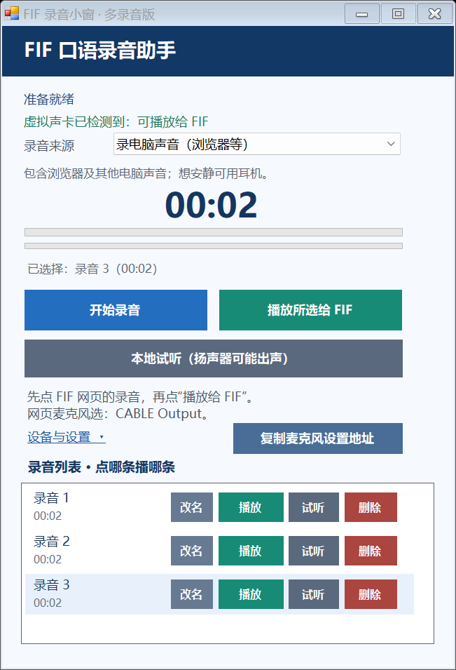

# FIF Audio Float / FIF 录音悬浮窗

**v1.3.0**

FIF Audio Float（FIF 录音悬浮窗）是面向 Windows x64 的本地 WinForms 小工具：录制电脑声音或麦克风、管理多条 WAV，并通过 VB-CABLE 把选中的一条作为网页麦克风输入播放。

## 功能

- **两种录音来源**：录制所选 Windows 输出端的电脑声音，或录制真实麦克风。
- **多条录音列表**：每完成一次正常录音都会新增一条记录；也可以批量导入兼容的 WAV，点哪条就播放哪条。
- **批量导入**：支持 16 位 PCM WAV，单声道或双声道，8–96 kHz，单个文件最大 120 MB。
- **逐条播放**：把列表中的某一条固定送往 `CABLE Input`；本地试听则送往真实耳机或扬声器。
- **本地管理**：改名、试听、直接删除、右键移出列表。默认编号会自动补齐，自定义名称保留。
- **明确边界**：不操作 FIF 网页，不提交录音，也不参与评分；网页录音的开始、结束、回放和提交均由使用者自己完成。



> 上图为合成示例，仅展示界面结构，不含真实录音、账户信息或页面内容。

## 文档导航

- **使用**：[下载与安装](#下载与安装) · [快速使用](#快速使用) · [设备与路由](#设备与路由) · [录音列表与文件](#录音列表与文件) · [故障排查](#故障排查)
- **维护**：[制作与验证](docs/制作与验证.md) · [虚拟机迁移与恢复](docs/虚拟机迁移与恢复.md) · [原理与架构](docs/原理与架构.md)
- **获取**：[GitHub 仓库](https://github.com/zhangenzhi233/fif-audio-float) · [Releases](https://github.com/zhangenzhi233/fif-audio-float/releases/latest)

## 下载与安装

打开 [GitHub Releases](https://github.com/zhangenzhi233/fif-audio-float/releases/latest)，下载最新 Windows x64 发布包。本说明对应 **v1.3.0**。

下载后解压到一个当前用户可写的普通文件夹，运行 `FifFloat.exe`。解压后的程序日常使用不需要管理员权限，也不要把程序放在需要管理权限才能写入的位置。

| 项目 | 要求 |
| --- | --- |
| 操作系统 | Windows x64 |
| 运行时 | 需要已安装 .NET Framework 4.8 |
| 虚拟声卡 | VB-CABLE，仅在“播放给 FIF”时需要，需单独安装 |
| 权限 | 解压后的程序日常运行无需管理员权限 |

### 单独安装 VB-CABLE

VB-CABLE 是独立的第三方虚拟声卡，不在本程序仓库或发行包中。本程序不包含、不下载也不自动安装驱动；请不要把 VB-CABLE 驱动安装包放入主程序仓库。

请只从 [VB-Audio 官方页面](https://vb-audio.com/Cable/) 获取 VB-CABLE，并按官方说明安装和重启。驱动安装程序本身可能需要管理员权限；这不是本程序日常运行的要求。

安装后，**不要把 `CABLE Input` 设为 Windows 默认扬声器**。Windows 的默认播放设备应保持为真实耳机或扬声器，否则系统声音可能被送入虚拟通道而听不到。本工具会自动把“播放给 FIF”送往 `CABLE Input`，不需要你修改默认设备。

## 快速使用

### 1. 设置网页麦克风

以 Edge 为例：

1. 打开 FIF 网页。
2. 点击小窗上的“复制麦克风设置地址”。这个按钮只会复制 `edge://settings/content/microphone` 到剪贴板，不会打开页面，也不会修改浏览器设置。
3. 将地址粘贴到 Edge 地址栏并按 Enter。
4. 在网页或 Edge 的麦克风设置中，把输入设备选为 `CABLE Output (VB-Audio Virtual Cable)`；如有麦克风权限提示，请允许。
5. 返回 FIF 页面并刷新。先按下一步准备好录音，再按“播放给 FIF”的步骤开启网页录音。

### 2. 录音或导入 WAV

展开“设备与设置”，先确认以下设备：

- **录音来源为“录电脑声音”**：选择浏览器实际使用的耳机或扬声器。它捕获的是这个 Windows 输出端上的所有应用混音，**不是某一个 Edge 标签页**。
- **录音来源为“录麦克风”**：选择真实麦克风。
- **本地试听输出**：选择真实耳机或扬声器。试听会从该设备出声，使用扬声器时可能被周围听到。

然后：

1. 点“开始录音”，说话或播放网页声音，确认电平条有变化，再点“结束录音”。
2. 每完成一次正常录音，列表中会新增一条；反复开始/结束录制即可形成多条列表。
3. 已有录音可点“设备与设置”中的“导入”批量加入。文件必须为 **16 位 PCM WAV**，**单声道或双声道**，采样率 **8–96 kHz**，单个文件不超过 **120 MB**。
4. 导入时会把文件复制到程序旁的 `录音/` 目录；之后移动或删除原始文件，不会影响列表中的已导入项。

录音和播放不能同时进行。需要播放时，请先结束本工具的录音。

### 3. 播放给 FIF

1. **先在 FIF 网页点开始录音**，并确认网页麦克风是 `CABLE Output`。
2. 回到小窗，在列表中点目标录音那一行的“播放”；也可以先选中该行，再点上方“播放所选给 FIF”。
3. 工具会把选中的这一条固定送往 `CABLE Input (VB-Audio Virtual Cable)`。播放期间可点“停止播放”；一条播完后不会自动播放下一条。
4. 之后由你在网页结束录音、回放和提交。本程序不会自动开始或结束网页录音，也不会提交或评分。

点行内“试听”只做本地试听，不会送往 FIF。本地试听会从所选的真实耳机或扬声器出声；如果选择扬声器，可能直接外放。

## 设备与路由

| 位置或操作 | 应选择的设备 |
| --- | --- |
| 工具“录电脑声音”的录音来源设备 | 浏览器实际播放声音的耳机或扬声器 |
| 工具“播放给 FIF” | 固定为 `CABLE Input (VB-Audio Virtual Cable)`，无需手选 |
| Edge / 网页麦克风 | `CABLE Output (VB-Audio Virtual Cable)` |
| 工具“本地试听” | 真实耳机或扬声器，不使用虚拟通道 |

`CABLE Input` 是 VB-CABLE 的播放端，`CABLE Output` 是录音端。网页取得声音要走 Output，工具送入声音要走 Input，两者不要选反。

## 录音列表与文件

- 默认名称从“录音 1”开始连续编号；删除中间的默认命名条目后，编号会重新补齐。
- 手动改过的名称会保留，改名不会改变 WAV 文件名。
- 点击某条录音的“播放”只处理该条，不会自动切到下一条或改变网页状态。
- “删除”会直接删除对应的 WAV 文件，不创建副本，也不移动到回收站；程序内没有撤销操作。
- 右键某一行可“移出列表（保留 WAV 文件）”。这只隐藏列表条目，音频仍留在 `录音/` 目录。
- 程序旁的 `录音/` 目录保存 WAV 和列表元数据 `录音列表.json`。重装、迁移或清理前，如需保留录音，请先备份这个目录。

## 使用边界

- 本工具只负责本地录音、列表管理和向 CABLE 播放，不读取网页内容，不提交录音，也不参与评分。
- “录电脑声音”会录入所选输出端的所有应用声音，不是只录一个标签页；通知音、其他应用和网页声音都可能进入同一段录音。需要安静时可使用耳机。
- “本地试听”会从真实耳机或扬声器出声，可能外放；它不会把声音送入 FIF。
- 需要网页收音时，必须由你先在网页开始录音，再在工具中点选播放。工具不会代替你结束网页录音、回放或提交。
- 本工具不会自动把 `CABLE Input` 设为系统默认扬声器，也不要手动这样设置。

## 故障排查

多数问题都是设备选错。先打开 Windows 声音设置和小窗的“设备与设置”，核对浏览器输出、录音来源设备、本地试听输出，并点“刷新”后重试。

| 现象 | 检查与处理 |
| --- | --- |
| 设备选错或切了耳机后没有声音 | 确认浏览器实际使用的输出端就是工具“录电脑声音”选中的设备；切换耳机、扬声器或虚拟机音频设备后，点“刷新”重新选择。 |
| 内录没有电平或录成无声 | 检查 Windows 音量和静音、浏览器标签页是否静音、网页是否正在发声；确认“录电脑声音”选择的是真实输出端，而不是 `CABLE Input`。麦克风来源则应选择真实麦克风并允许权限。 |
| 提示未检测到 CABLE | 从 [VB-Audio 官方页面](https://vb-audio.com/Cable/) 安装 VB-CABLE，重启后点“刷新”。在 Windows 声音设置中确认同时存在 `CABLE Input`（播放）和 `CABLE Output`（录音）。本工具不会在没有 CABLE 时退回到系统扬声器。 |
| 网页收不到声音 | 网页麦克风应选 `CABLE Output`，不是 `CABLE Input`；先在网页开始录音，再点对应行的“播放”。同时检查浏览器站点麦克风权限，必要时刷新网页。 |
| 本地试听没有声音 | 在“本地试听输出”中选择真实耳机或扬声器，不要选择虚拟通道；再检查 Windows 音量。 |
| 虚拟机中设备不对或没有声音 | 先在虚拟机设置中启用音频设备，并确认宿主机有可用的播放端；进入虚拟机后重新选择录音来源和输出设备。远程桌面、音频重定向或设备直通可能改变可见设备。宿主机上通过的配置不能直接当作虚拟机验收结果。 |
| “复制麦克风设置地址”没有打开设置页 | 这是预期行为：按钮只复制地址。请手动粘贴到 Edge 地址栏并按 Enter。 |

## 从源码构建与自检

普通下载用户不需要构建。需要在 Windows 上从源码构建时，请在仓库根目录打开 PowerShell，运行：

```powershell
powershell.exe -NoProfile -ExecutionPolicy Bypass -File .\build.ps1
```

这里的 `-ExecutionPolicy Bypass` 只对本次 `powershell.exe` 进程生效，不修改系统或用户的全局执行策略；`-NoProfile` 避免个人 PowerShell 配置干扰构建。构建依赖 Windows x64、.NET Framework 4.8 和系统 C# 编译器，输出位于 `bin\`。

构建后可运行离线自检：

```powershell
.\bin\FifFloat.exe --self-test .\self-test.json
```

自检只使用程序生成的合成音频，**不安装驱动、不采集真实麦克风**，也不会打开 FIF 网页。它会在报告所在目录创建隔离的测试数据；请使用可写的临时目录，不要把真实录音目录作为报告输出位置。自检通过不等于网页收音、虚拟机音频路由或评分链路已经通过。

如果需要进行 CABLE 选择检查，可使用：

```powershell
.\bin\FifFloat.exe --probe-selection .\probe-selection.json
```

该检查需要已安装完整可用的 VB-CABLE，属于维护者验证命令，不是离线自检。它会通过虚拟设备播放和捕获合成音，普通用户不需要运行；没有 CABLE 时不要运行。详细说明见 [制作与验证](docs/制作与验证.md)。

## 验证范围

根据用户反馈，v1.3.0 已在一台 Windows 虚拟机中安装成功；该反馈仅覆盖安装环节。虚拟机中的实际 FIF 网页收音、回放质量和评分尚未验证，本说明不将其表述为已通过。

在目标机器和实际页面开始使用前，建议按 [虚拟机迁移与恢复](docs/虚拟机迁移与恢复.md) 做一次不含隐私内容的短录音验收。安装成功不等于音频路由、浏览器权限和评分流程都已验证。

## 许可证

本项目代码采用 [MIT 许可证](LICENSE)，允许在保留版权和许可声明的条件下使用、修改及分发。

随附的 `lib/NAudio.dll` 为 NAudio 1.10，使用 Microsoft Public License (Ms-PL)。完整文本与来源见 [THIRD_PARTY_NOTICES.md](THIRD_PARTY_NOTICES.md)。
